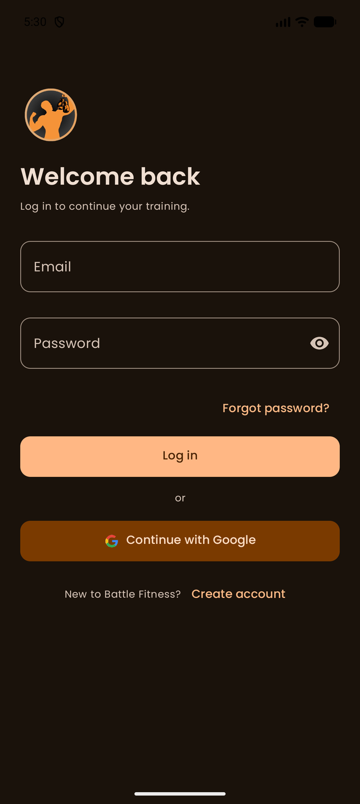
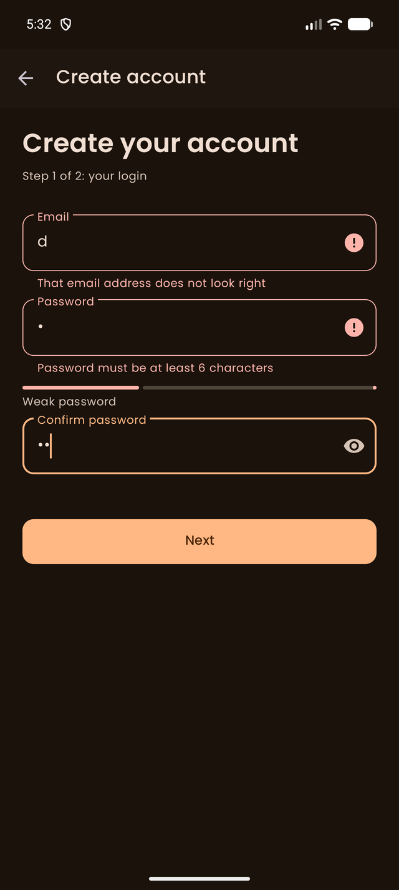
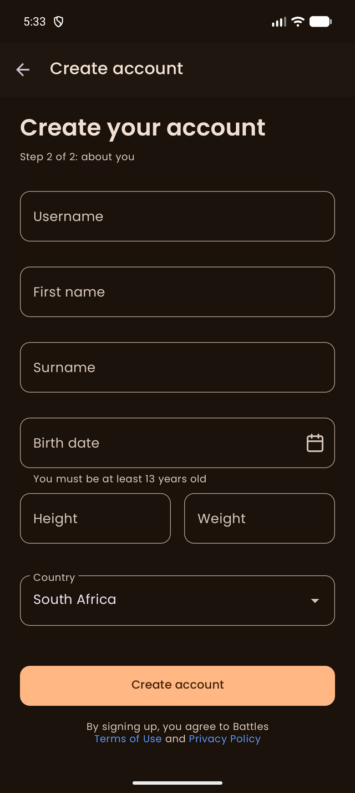
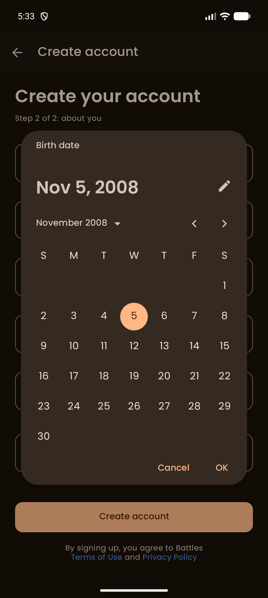
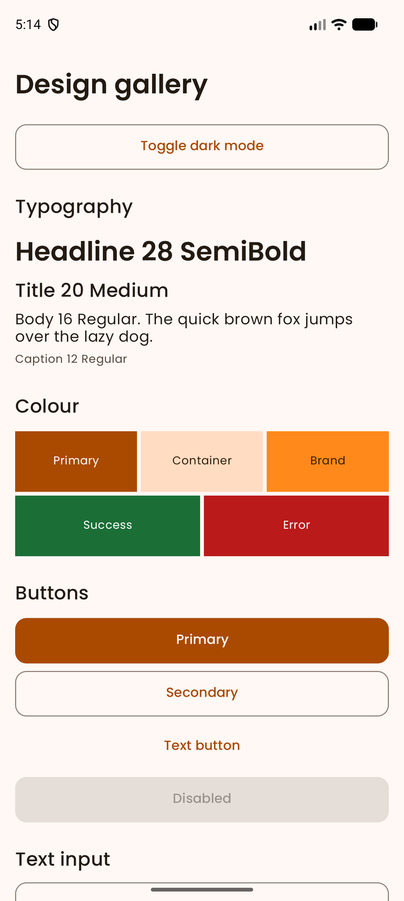
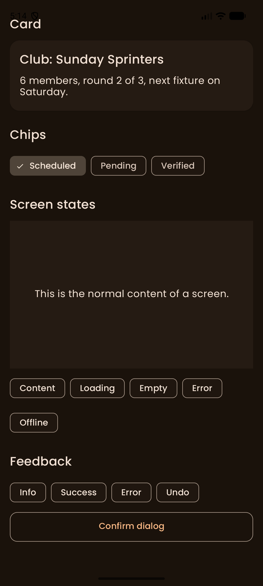

# Battle Fitness (OPSC Mobile Application)

An Android application built with **Kotlin** and **XML / Material 3 UI components**, designed to let friends join fitness **clubs**, compete in a **round-robin league** with a referee, log workouts **offline**, and stay up to date with **push and in-app notifications**.

This project was developed as part of practical software engineering coursework (OPSC6312 Portfolio of Evidence, Part 3) to demonstrate secure authentication with single sign-on, a NoSQL cloud database, offline-first storage with background sync, a public REST API, multi-language support, and preparation of an app for the Google Play Store.

**Developed by:** Ethan Carr and Insaaf Behardien

---

## 🎯 Purpose & Design Considerations
Battle Fitness turns working out into a friendly competition. A group of friends creates a **club**, the club owner starts a **league**, and every member plays every other member **three times**. A third member who is not playing acts as the **referee**, enters the scores and attaches a proof photo. A win earns **3 points**, a draw **1** and a loss **0**. When every fixture is verified, the member with the most points wins the league.

* **Offline first:** Workouts are always saved on the phone first (Room / SQLite) and uploaded when the connection returns, so the app is useful in a gym with no signal.
* **Simple, modern look:** One design system (`docs/design-system.md`): Poppins typography, rounded cards, a bottom navigation bar, dark mode by default with a Light / Dark / System switch, and the same loading, empty, error and offline states on every screen.
* **Accessible by design:** Text and button colours are checked against **WCAG 2.2 contrast** rules by a unit test (`DesignContrastTest`), touch targets are at least 48dp, and icons and images have a content description or are marked decorative.
* **Forgiving input:** Every form validates as the user types and shows a clear message next to the field. Bad input, a missing network or a wrong password never crashes the app.
* **Privacy and security:** Passwords are never stored by the app. Firebase Authentication hashes them, and Firestore security rules (`firestore.rules`) keep workouts private and let only club members see a club.
* **Three languages:** English, Afrikaans and isiZulu, switchable inside the app without restarting.
* **Changed from the Part 1 plan:** Part 1 planned our own ASP.NET API with Azure SQL. We moved to **Firebase** (Authentication, Firestore, Cloud Messaging) so that login, single sign-on and real-time updates work without hosting a server. Passwords are therefore hashed by Firebase Authentication instead of our own BCrypt/Argon2 code.

---

## 🚀 Key Features
* **Secure Authentication Flows:** Two-step registration (login details, then profile), login, forgot-password email, log out, and a saved session (`AuthActivity`, `LoginFragment`, `SignUpAccountFragment`, `SignUpProfileFragment`, `ForgotPasswordFragment`) with live password-strength feedback and a minimum age of 13.
* **Single Sign-On (SSO):** "Continue with Google" through Android Credential Manager and Firebase Authentication (`GoogleSignInHelper`). A first-time Google user finishes a short profile (`FinishProfileFragment`) and returning users go straight in.
* **Settings & Languages:** A settings screen (`SettingsFragment`) for editing the profile, metric or imperial units, theme, notifications, language (English, Afrikaans, isiZulu), changing the password and deleting the account.
* **Offline Mode with Sync:** Workouts are saved in a **Room** database first. A **WorkManager** job (`SyncWorker`) uploads them when the phone is back online, with no duplicates, offline deletes and a "Pending / Synced" badge on every workout.
* **Workout Logger & Dashboard:** A monthly goal ring, streak and totals, a log-workout sheet, swipe-to-delete with undo, a "Sync now" action and a Home screen with your clubs and next fixture (`WorkoutsFragment`, `HomeFragment`).
* **REST API Exercise Library:** Browse and search exercises from the public **wger** REST API with category filters, a detail screen and an offline cache (`exercises/`).
* **Clubs & League (User Defined Feature 4):** Create a club, share a 6-character invite code, join by code, start the league (3 to 12 members), see the podium leaderboard and fixtures by round, and let the referee enter results (`clubs/`, `LeagueEngine`).
* **Profile Customisation (User Defined Feature 5):** Avatar and banner from the gallery or camera, cropped and compressed, a bio, personal stats, and read-only profiles of other club members (`profile/`, `media/`).
* **Push & Real-Time Notifications:** Firebase Cloud Messaging token handling, three notification channels (Fixtures, Referee requests, Leaderboard), the Android 13+ permission flow, tap-to-open, and an **in-app bell with a live unread badge** driven by a Firestore listener (`notifications/`).
* **App Icon & Image Assets:** Adaptive launcher icon (with a themed monochrome layer), splash screen, Play Store icon and feature graphic (`docs/store/`).

---

## 🛠️ Technology Stack & Architecture
* **Language:** Kotlin
* **UI Framework:** Android XML Layouts, Material Components (Material 3), View Binding, Navigation component, Poppins font
* **Architecture / Components:** Fragments inside two activities (`AuthActivity`, `AppActivity`), ViewModels with Kotlin coroutines and Flow, repository classes for data access, pure-Kotlin logic classes for the rules (`LeagueEngine`, `WorkoutLogic`, `Validators`) so they can be unit tested
* **Authentication:** Firebase Authentication (email and password) and Google sign-in through Credential Manager
* **Cloud Database (NoSQL):** Cloud Firestore with security rules (`firestore.rules`)
* **Offline Storage & Sync:** Room (SQLite) and WorkManager
* **REST API:** Retrofit and OkHttp against the public wger exercise API
* **Push Notifications:** Firebase Cloud Messaging
* **Image Storage:** Compressed images stored as blobs in Firestore documents (see Known Limitations)
* **Image Loading:** Coil
* **Build System:** Gradle with Kotlin DSL (`build.gradle.kts`) and a version catalog (`gradle/libs.versions.toml`), Android Gradle Plugin 9.2.1, Kotlin 2.2.10
* **SDK Levels:** `minSdk` 24, `targetSdk` 36, application ID `com.battlefitness.app`
* **Version Control & CI:** GitHub and GitHub Actions workflow (`android-tests.yml`) that runs unit tests, lint and builds the debug APK

### Firestore data model
```text
users/{uid}                          profile, settings, fcmToken
users/{uid}/workouts/{workoutId}     synced workouts (private to the owner)
users/{uid}/notifications/{id}       in-app notifications for that user
clubs/{clubId}                       ownerId, name, inviteCode, memberIds, status
clubs/{clubId}/fixtures/{fixtureId}  player ids, referee, round, status, scores, proof photo
clubs/{clubId}/standings/{uid}       points, played, won, drawn, lost
```

---

## 📂 Project Structure
```text
OPSC/
│
├── .github/workflows/         # Automated Android CI pipeline (tests, lint, debug APK)
├── app/src/main/
│   ├── java/com/example/opsc/
│   │   ├── auth/              # Login, sign-up, Google SSO, validators, password strength
│   │   ├── app/               # AppActivity (bottom navigation) and the Home dashboard
│   │   ├── workouts/          # Room database, repository, WorkManager sync, logger screens
│   │   ├── exercises/         # wger REST API client, mapper, Room cache, library screens
│   │   ├── clubs/             # Clubs, league engine (fixtures, referees, standings), result entry
│   │   ├── profile/           # Profile screens, language manager, units
│   │   ├── settings/          # Settings, change password, re-authentication prompt
│   │   ├── notifications/     # FCM service, channels, in-app notification list
│   │   ├── media/             # Image crop and compress, blob store, picture cache
│   │   └── ui/                # Shared UI: state layout, snackbars, connectivity, theme manager
│   └── res/                   # Layouts, navigation graphs, fonts, colours, icons
│       ├── values/            # English strings, theme and design tokens
│       ├── values-af/         # Afrikaans strings
│       ├── values-zu/         # isiZulu strings
│       └── values-night/      # Dark-mode colours
├── app/src/test/              # 178 unit tests (validators, league rules, sync, mapper, contrast)
├── docs/                      # Design system, Firebase setup, references, AI log, store assets
├── firestore.rules            # Firestore security rules
├── storage.rules              # Firebase Storage rules (prepared, see Known Limitations)
├── build.gradle.kts           # Project build configurations (Kotlin DSL)
└── settings.gradle.kts        # Gradle settings and repositories
```

---

## 🖼️ Screenshots
| Login | Sign-up with validation | Sign-up step 2 |
|---|---|---|
|  |  |  |

| Birth date picker | Design system (light) | Design system (dark) |
|---|---|---|
|  |  |  |

<!-- TODO: add final screenshots of Home, Workouts, Clubs, Club detail and Profile to docs/images and link them here. -->

---

## ⚙️ Setup & Local Installation

1. **Clone the Repository:**
   ```bash
   git clone https://github.com/Ethan1ol/OPSC.git
   ```
2. **Create your Firebase config:**
   `google-services.json` is never committed. Follow `docs/firebase-setup.md` to create a Firebase project, add the Android app (`com.battlefitness.app`) with your debug SHA-1 and SHA-256, enable **Email/Password** and **Google** sign-in, create **Firestore**, and publish `firestore.rules`. Download `google-services.json` and place it in the `app/` folder.
3. **Open in Android Studio:**
   Launch Android Studio, select **Open**, and choose the cloned `OPSC` root directory.
4. **Sync Gradle:**
   Allow Android Studio to sync and download the required Gradle dependencies (`build.gradle.kts`).
5. **Run the Application:**
   Connect a physical Android device with USB debugging, or start an Android Emulator that uses a **Google Play** system image (API 24+), then click the **Run ('>')** button. Google sign-in and push notifications need Google Play services.

---

## 🧪 Testing & CI
* Includes **178 unit tests** covering the input validators, password strength, league rules (fixtures, balanced referees, standings), workout sync decisions, goal and streak maths, exercise API mapping, image maths, unit conversion, notification logic, theme mode and colour contrast.
* Run them locally with:
  ```bash
  ./gradlew testDebugUnitTest
  ```
* Logging with `android.util.Log` is used for sign-in, sync, API calls, notifications and errors, so behaviour can be followed in Logcat.

---

## 🔄 GitHub & GitHub Actions
* **Version control:** The project is developed with regular, small commits. Part 3 was built on a `part3` branch and merged into `master`, and the final commit is tagged **final PoE**.
* **Automated pipeline (`.github/workflows/android-tests.yml`):** Runs on every push to `main`, `master`, `dev` and `part3`, and on pull requests to `main` and `master`.
  1. Checks out the code and sets up JDK 17 and Gradle with a dependency cache.
  2. Creates `google-services.json` from the encrypted GitHub secret `GOOGLE_SERVICES_JSON`, so the real file is never in the repository.
  3. Runs the unit tests (`./gradlew testDebugUnitTest`).
  4. Builds the debug APK (`./gradlew assembleDebug`).
  5. Runs Android lint (`./gradlew lintDebug`).
  6. Uploads the unit-test report, the lint report and the debug APK as downloadable artifacts.
* This confirms the app builds and the tests pass on a clean machine, not only on a developer's computer.

---

## 📝 Release Notes
### Version 1.0 (Part 3, final submission)
Everything below was added or changed since the Part 2 prototype, which had a login screen, a sign-up form and empty Home and Settings screens. Features marked ⭐ are our innovative additions for this version.

**New**
* ⭐ **Clubs and league (UD4):** invite codes, a league engine that generates every fixture three times, balances the referee duty between members, and works out the standings and the league champion.
* ⭐ **Profile customisation (UD5):** avatar and banner with an on-device crop, shrink and compress pipeline, plus read-only member profiles.
* ⭐ **Offline-first workout sync:** Room as the single source of truth, version numbers so an edit made during an upload is never lost, and offline deletes with undo.
* ⭐ **In-app real-time notifications:** a live bell badge from a Firestore listener that shows in each phone's own language.
* ⭐ **Referee proof photos** attached to a fixture result.
* **Single sign-on** with Google, with a "finish your profile" step for new users.
* **Push notifications** with Firebase Cloud Messaging, channels and the Android 13+ permission flow.
* **Multi-language support:** English, Afrikaans and isiZulu.
* **REST API exercise library** using the public wger API, with local search and an offline cache.
* **Workout Logger and Dashboard** with a monthly goal ring, streak and totals.
* **Settings:** units, theme, language, change password and delete account.
* **App icon, splash screen** and Play Store graphics.
* **GitHub Actions** pipeline, 178 unit tests, security rules, a privacy policy draft and full documentation.

**Changed**
* Rebuilt login and sign-up as a clean two-step flow with live validation and a password strength hint.
* New Material 3 design system with dark mode by default and a bottom navigation bar.
* Moved from the planned custom API to Firebase (see Design Considerations).
* The package for the Play Store is `com.battlefitness.app` because Google Play does not accept `com.example`.

**Fixed (from the prototype and lecturer feedback)**
* The sign-up form had a duplicated name check, never showed the date picker, showed the wrong error text for the birth date, and hid the surname field like a password.
* The login did not check credentials and the Google button only opened Home. Both now use Firebase.
* The Gradle build referenced a missing plugin and had unused Compose libraries.
* **Missing list of references and AI declaration (Part 2 feedback):** both are now included in this README.

---

## ⚠️ Known Limitations
* **Push to a closed app:** The Firebase project is on the free Spark plan, which has no Cloud Functions. The app saves its push token and handles incoming pushes, but a push to another phone while the app is closed has to be sent from the Firebase console. In-app notifications update in real time while the app is open. See `docs/push-notifications.md`.
* **Image storage:** Firebase Storage needs the paid Blaze plan, so avatars, banners and proof photos are compressed to under 700 KB and stored as blobs in Firestore. Because of this, proof is a **photo**, not a video as first planned in Part 1. `storage.rules` is prepared in case the project moves to Blaze later.
* **Translations:** The Afrikaans and isiZulu text was written with AI help and is waiting for a first-language speaker to check it (`docs/translation-review.md`).

---

## 🎥 Demonstration Video
Watch the full demonstration (recorded on a physical Android phone, with voice-over): **[add the unlisted YouTube link here]**

---

## 📦 Play Store Preparation
* **Done:** unique application ID, adaptive icon and splash screen, Play Store icon (`docs/store/play-icon-512.png`), feature graphic (`docs/store/feature-graphic-1024x500.png`), a privacy policy draft (`docs/privacy-policy.md`), Android 13+ notification permission handling, and a debug build produced by the CI pipeline.
* **Still to add as evidence:** signed release APK or app bundle, Play Console screenshots and the screenshot of the Play Console upload, if applicable.

---

## 🤖 AI Declaration
**Tools used:** Claude Code (Claude Sonnet 5.5) and the Claude app (Claude Opus 5.5), both by Anthropic (2026). See the references below.

**How AI was used**
* **Code:** Claude Code wrote most of the Kotlin code, XML layouts, Gradle configuration, Firestore security rules and unit tests, one feature at a time. We gave the requirements from our Part 1 plan and reviewed the results.
* **Debugging:** It helped find and fix build errors, for example a Gradle plugin that was missing from the version catalog, library versions that did not match the Kotlin compiler, a text font weight that was not applied, and an uneven referee rotation that a unit test exposed.
* **Research:** It checked the live wger API before the code was written, which showed that its search endpoint was unusable, so the app downloads the exercise list and searches it on the phone.
* **Translations:** The Afrikaans and isiZulu text was generated by AI and has not yet been checked by a first-language speaker.
* **Images:** The launcher icon, Play Store icon and feature graphic were generated with an AI-written Pillow script from our own team logo. The screenshots in `docs/images` are real emulator captures, not generated images.
* **Documents:** AI drafted the privacy policy, the Firebase setup guide, the design system notes, the prompts we gave Claude Code and this README.

**What we did ourselves:** We set the requirements, chose the app design and the Firebase plan, created the Firebase project and GitHub repository, tested the app on the emulator and the phone, and reported the bugs that were then fixed. [Ethan and Insaaf: add anything else you reviewed, changed or wrote yourselves.]

**Cited and logged:** Every adapted source is listed below and in the code comments (`// Adapted from:`). The full record of what AI produced in each piece of work is in `docs/ai-usage-log.md`.

---

## 📚 References
Harvard style. The same list is kept in `docs/references.md`.

<details>
<summary>Show all references</summary>

Android Developers (2026) *Localize your app*. Available at: https://developer.android.com/guide/topics/resources/localization (Accessed: 5 November 2026).

Coil Contributors (2026) *Coil 3: image loading for Android and Kotlin Multiplatform*. Available at: https://coil-kt.github.io/coil/ (Accessed: 5 November 2026).

Firebase (2025) *Firebase Cloud Messaging*. Available at: https://firebase.google.com/docs/cloud-messaging (Accessed: 3 November 2025, as listed in the assignment brief).

Firebase (2026) *Add data to Cloud Firestore*. Available at: https://firebase.google.com/docs/firestore/manage-data/add-data (Accessed: 5 November 2026).

Google (2026) *Material Design 3: Color roles*. Available at: https://m3.material.io/styles/color/roles (Accessed: 5 November 2026).

Google Fonts (2026) *Poppins* (SIL Open Font License 1.1). Available at: https://fonts.google.com/specimen/Poppins (Accessed: 5 November 2026).

Google for Developers (2026) *Authenticate your client (SHA-1 certificate fingerprint)*. Available at: https://developers.google.com/android/guides/client-auth (Accessed: 5 November 2026).

Gradle Inc. (2026) *Version catalogs*. Available at: https://docs.gradle.org/current/userguide/version_catalogs.html (Accessed: 5 November 2026).

wger Workout Manager (2026) *REST API documentation: exercise, exercise-translation, exercisecategory, muscle and equipment endpoints*. Available at: https://wger.de/en/software/api (Accessed: 5 November 2026).

</details>
